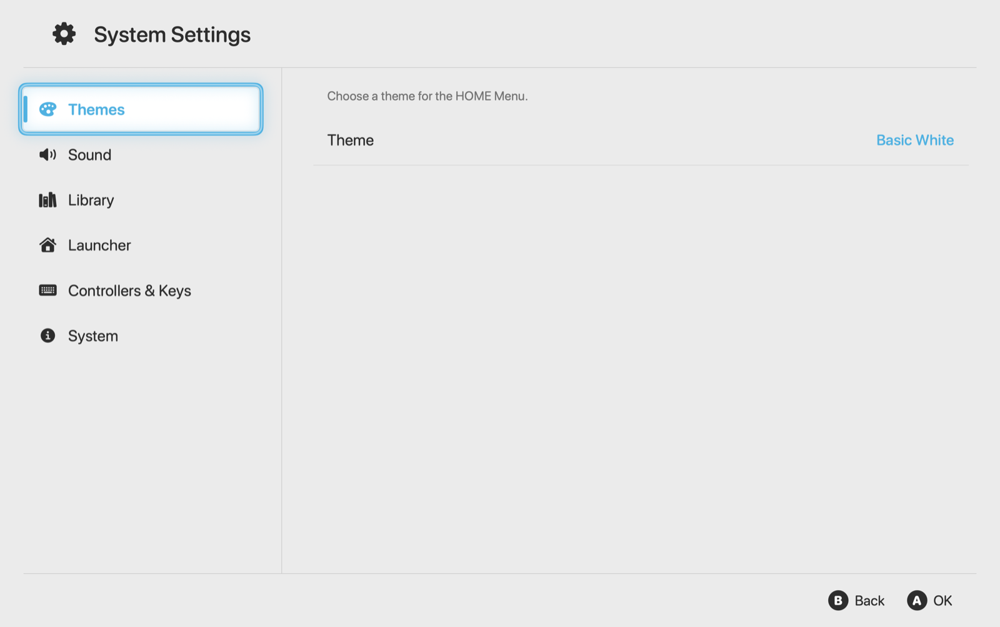
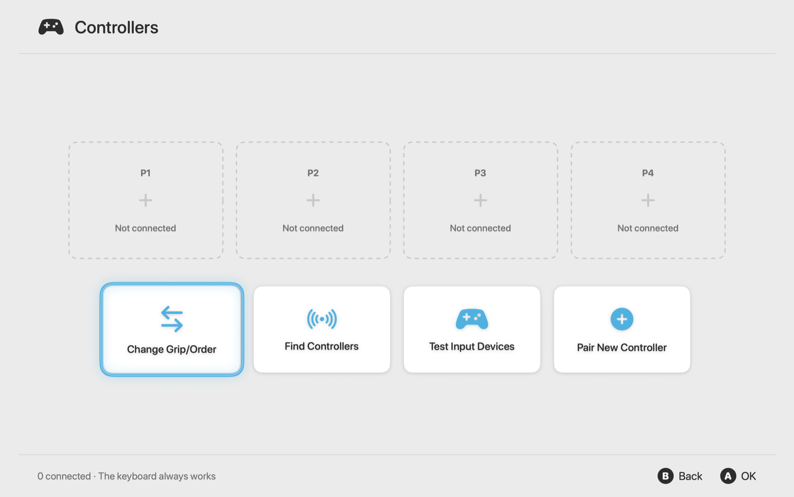
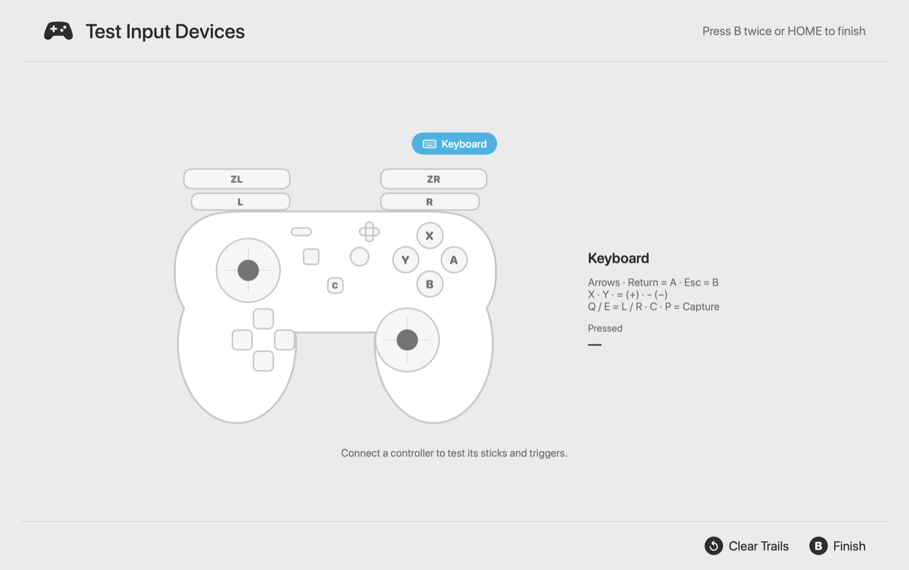

# Switch Launcher

A native macOS launcher for Nintendo Switch games ported to Apple silicon, modelled on the
Nintendo Switch 2 HOME Menu. Built with SwiftUI, driven by keyboard or game controller.

It finds the game apps produced by [nxnative](https://github.com/seedds/nxnative) /
[MacNativeGames](https://github.com/ly05010419/MacNativeGames), shows them as a console-style
software row, and starts them full screen on top of the launcher. HOME brings you back.

> Not affiliated with or endorsed by Nintendo. Switch Launcher contains no game code, keys or
> artwork; it only launches apps you have already built from your own dumps.

| System Settings | Controllers | Test Input Devices |
|---|---|---|
|  |  |  |

## Features

- **HOME Menu**: the 12 most recent titles plus All Software, the console's ten round shortcuts
  (Nintendo Switch Online, GameChat, News, Nintendo eShop, Album, GameShare, Controllers,
  Virtual Game Cards, System Settings, Sleep Mode), status bar with clock, network and battery,
  and a button guide. Basic White and Basic Black themes, or follow macOS.
- **Playing**: games open full screen on top of the launcher and get keyboard focus. The launcher
  keeps it there if a background app tries to take it, and comes back when you press HOME on a
  controller or quit the game. Play time is recorded per title.
- **All Software**: grid with four sort orders, per-title options (information, play activity,
  data management) and Virtual Game Cards to choose what appears on HOME.
- **Controllers**: player slots with lights and battery, Change Grip/Order (L + R), Find
  Controllers (vibration), Test Input Devices (live buttons, sticks with movement trails, analog
  triggers) and pairing.
- **Also**: Quick Settings (hold HOME), Capture to Album, Sleep Mode, in-app pages for Nintendo
  Switch Online, News and eShop, boot and launch animations, synthesized interface sounds.

## Requirements

- macOS 15 or later on Apple silicon
- Xcode 16 or later (Swift 6 toolchain) to build

## Install

Download `Switch-Launcher-<version>.zip` from the releases page, unzip, and move
**Switch Launcher.app** to `/Applications`. The app is ad-hoc signed, so the first time,
right-click it and choose **Open**.

Or build it yourself:

```bash
make install      # build and copy to /Applications
```

On first launch macOS asks for access to the Documents folder (where `Switch/apps` usually lives);
choose **Allow**.

## Library

These folders are scanned by default; change them in System Settings › Library:

- `~/Documents/Switch/apps`
- `/Applications`
- `~/Applications`

A bundle counts as a game when its `Info.plist` has a `DMTitleID`, its bundle id starts with
`org.nxnative.` or `org.macnativegames.` or ends in `.native`, or it contains a port's runtime
(`Contents/MacOS/dmhost`, `Contents/Resources/romfs` or `Contents/Resources/game`).
**Add Software…** adds any other Mac app.

## Controls

| Button | Keyboard | Action |
|---|---|---|
| D-pad / stick | Arrow keys | Move |
| A | Return / Space | OK, start software |
| B | Esc / Delete | Back |
| X | X | Close the running software |
| Y | Y | Change sort (All Software) |
| + / − | `=` / `-` | Software options |
| L / R | Q / E | Jump to first / last |
| HOME | H | HOME Menu; press again to resume the game. Works during a game on a controller. |
| Hold HOME | ⇧H | Quick Settings |
| Capture | P | Save a screenshot of the launcher to the Album |

The mouse works too: click once to select, again to open. The window has the standard close,
minimise and full-screen buttons (⌃⌘F).

## Development

```bash
make build    # debug build
make test     # unit tests
make run      # build the .app and open it
make dist     # dist/Switch-Launcher-<version>.zip + .sha256
```

| Module | What it holds |
|---|---|
| `DesignSystem` | Theme tokens, 1280×720 design-grid scaling, reusable console components (`GameTile`, `CircleIconButton`, `StatusBar`, `ButtonGuide`, `ConsoleScaffold`, `ItemRow`, `ConsoleDialog`, `selectionFrame`, …) |
| `LauncherCore` | `GameScanner`, `GameLibrary`, `GameLauncher` (launch, focus hand-off and guard, play time), `PlayHistory`, `SettingsStore`, `SystemStatus`, `ScreenshotLibrary`, `Log` |
| `InputKit` | `InputRouter`: keyboard and controllers → Nintendo buttons, stick repeat, HOME hold, rumble, player lights, live snapshots |
| `SoundKit` | `UISoundPlayer`: interface sounds synthesized at startup |
| `Features` | Screens and navigation; two-pane pages share `MenuModel` / `MenuView` |

Launch options for checking screens: `-openScreen settings|library|album|user|controllers|cards|options|dialog|web|tester|grip|quick|capture|last|middle|roundtrip`,
and `-launchGame <title>` to start a game directly.

Logs: `log stream --predicate 'subsystem == "dev.vinicius.switchlauncher"'`.
Settings and play history live in `~/Library/Application Support/SwitchLauncher/`.

CI builds and packages the app on every push. See [docs/CI.md](docs/CI.md).

## License

MIT. See [LICENSE](LICENSE).
